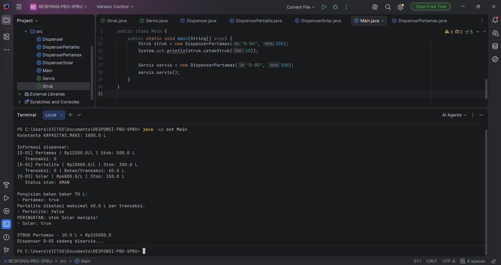

# Responsi Akhir PBO – Sistem SPBU

## Identitas
- **Nama:** KALINA AULIA BRILIANI
- **NIM :** H1D025002
- **Tema:** SPBU (digit terakhir NIM 2)

## Deskripsi Program
Program Sistem SPBU merupakan program berbasis Java yang menggambarkan proses pengisian bahan bakar di SPBU. Program ini menyediakan tiga jenis dispenser, yaitu Pertamax, Pertalite, dan Solar. Pengguna dapat melihat informasi dispenser, mengisi bahan bakar, menghitung total harga, mencetak struk, serta melakukan servis dispenser. Program ini dibuat dengan menerapkan berbagai konsep Pemrograman Berorientasi Objek (PBO).
## Cara Menjalankan Program

Sebelum menjalankan program, pastikan JDK sudah terpasang di komputer. Setelah itu, buka terminal pada folder utama repository dan jalankan perintah berikut:

```bash
javac -d out *.java
java -cp out Main
```

Perintah pertama digunakan untuk meng-compile seluruh file Java, sedangkan perintah kedua digunakan untuk menjalankan program melalui class `Main`.

## Screenshot Hasil Program

Berikut merupakan tampilan hasil program setelah dijalankan:



